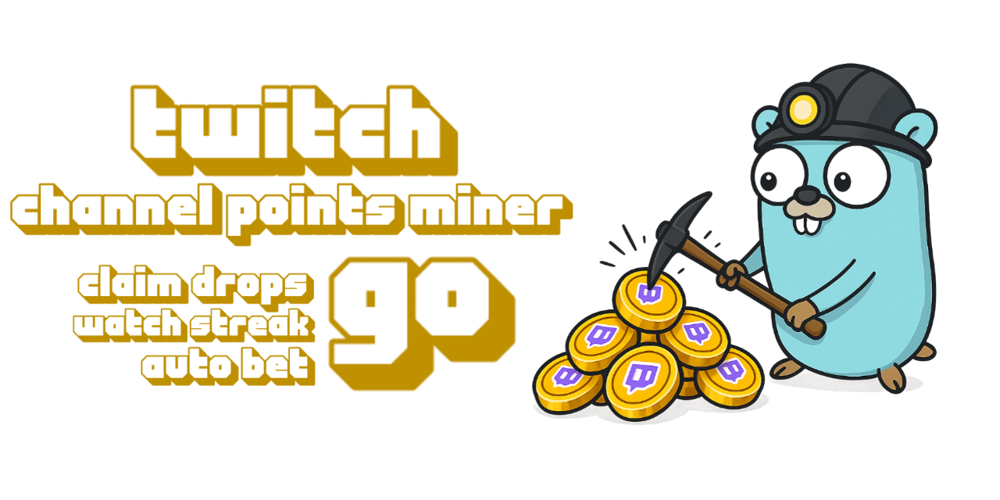

# Twitch Points Miner

[](https://github.com/kWAYTV/twitch-points-miner/actions/workflows/ci.yml)
[](https://github.com/kWAYTV/twitch-points-miner/actions/workflows/docker.yml)
[](LICENSE)

Earns Twitch channel points for you by watching streams in the background. Written in Go: one small binary, quick to start, light on CPU and memory.

## What it does

- Watches up to two live streams at a time and keeps watch streaks going.
- Claims bonus chests, drops and moments, and follows raids.
- Places predictions with configurable strategies and filters.
- Mines a list of streamers, or everyone you follow.
- Shows balances and history on a built-in web dashboard.
- Sends Discord and Telegram notifications in plain sentences.

## Quick start

Download [compose.yaml](compose.yaml) and [config.example.json](config.example.json), then:

```sh
mkdir data
cp config.example.json data/config.json   # set "username" in it
docker compose up -d
docker compose logs -f
```

The logs show a code once: open <https://www.twitch.tv/activate> and enter it. The login is saved, so later starts need nothing. The dashboard is at <http://localhost:5000>.

To run from source instead (Go 1.23 or newer): `go run ./cmd/twitch-miner`.

[Getting started](docs/getting-started.md) has the details: user ids and permissions, running without Compose, where files are kept, updating.

## Documentation

| Page | What it covers |
|---|---|
| [Getting started](docs/getting-started.md) | Installing, logging in, where files are kept, updating. |
| [Configuration](docs/configuration.md) | Every key in `config.json` with its default. |
| [Streamers and watching](docs/streamers.md) | Who gets mined, the two watch slots, streaks, drops, raids, per-streamer overrides. |
| [Predictions](docs/predictions.md) | Strategies, stake sizing, timing and filters. |
| [Notifications](docs/notifications.md) | Discord and Telegram setup, and the events you can choose. |
| [Dashboard](docs/dashboard.md) | The web page, remote access, stored history, the JSON API. |
| [Troubleshooting](docs/troubleshooting.md) | Login, permissions, an unreachable dashboard, missing notifications. |

## Development

```sh
sh ci/check.sh                        # format, vet, build and test, as CI does
git config core.hooksPath ci/hooks   # run it before every push
```

The code is organised by domain under `internal/`. See [CONTRIBUTING.md](.github/CONTRIBUTING.md) for the layout and conventions.

## Credits

- [0x8fv/Twitch-Channel-Points-Miner](https://github.com/0x8fv/Twitch-Channel-Points-Miner), the Go rewrite this project began as a fork of. This version reorganises the code and adds the dashboard, Telegram, notification sentences, the Docker image and CI.
- [rdavydov/Twitch-Channel-Points-Miner-v2](https://github.com/rdavydov/Twitch-Channel-Points-Miner-v2), the Python miner that inspired the rewrite.

## Licence and disclaimer

Released under [CC BY-NC 4.0](LICENSE), the licence of the project it derives from.

This project is not affiliated with Twitch and comes with no warranty. Automating an account can get it restricted or banned; you use it at your own risk.
